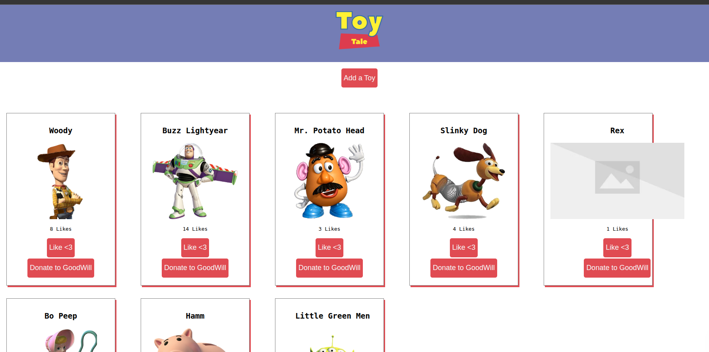

# Toy Tales

A React app that lets users manage a collection of toys, connected to a backend with fetch requests.

## Features
- See all toys when the page loads
- Add a new toy using the form
- Like a toy to increase its likes
- Donate (delete) a toy

## How to run
1. Run `npm install`
2. Start the backend: `npm run server`
3. Start the app: `npm run dev`
4. Run the tests: `npm run test`

## Screenshot
